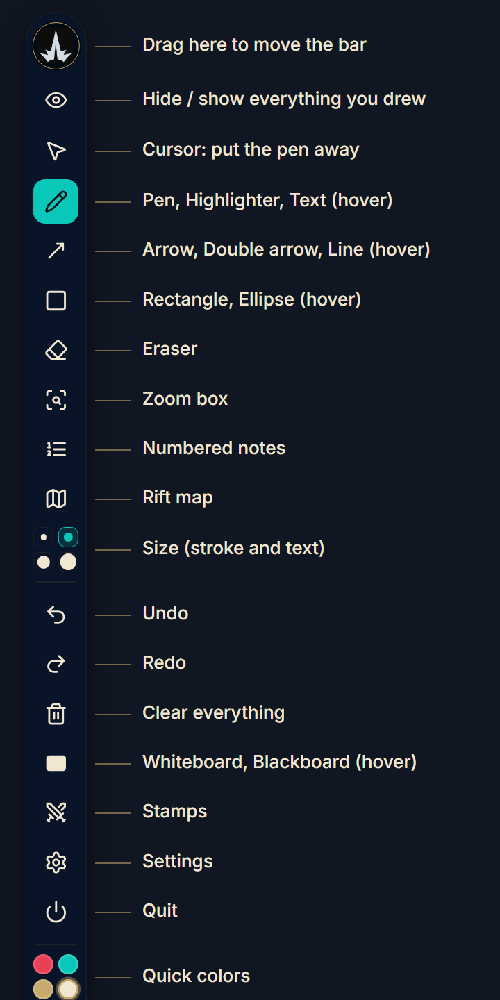
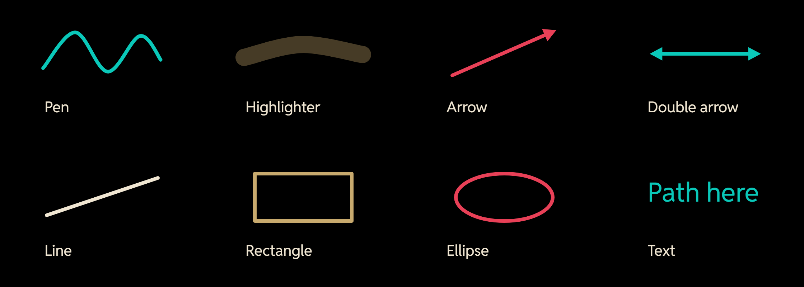
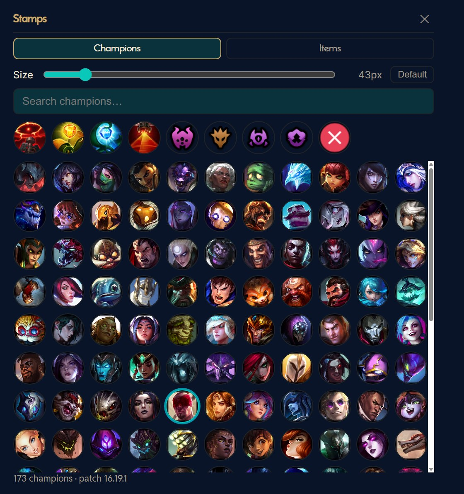
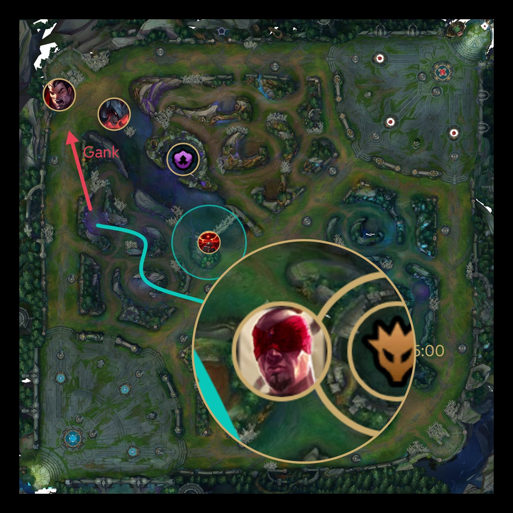

# Rift Pen

Rift Pen is Jungle Kingdom's League-themed screen-annotation overlay for Windows: draw, highlight,
zoom and spotlight over anything on screen while you coach.

**[Download the latest installer](https://github.com/Jungle-Kingdom/rift-pen-releases/releases/latest)**
(`RiftPen-Setup-<version>.exe`). Updates download in the background and install when you quit
(tray: Restart to update).

Rift Pen draws on top of whatever is on your screen: a VOD, a live game, a browser tab, OBS. You
pull the pen out, draw, and put it away again. While the pen is away your mouse works normally on
whatever is underneath.

This page covers what is in the app and how to use each part.

**Contents**

1. [Before you start](#1-before-you-start)
2. [Your first two minutes](#2-your-first-two-minutes)
3. [The toolbar](#3-the-toolbar)
4. [Drawing tools](#4-drawing-tools)
5. [The Rift map](#5-the-rift-map)
6. [Stamps](#6-stamps)
7. [Zoom](#7-zoom)
8. [Spotlight](#8-spotlight)
9. [Numbered notes](#9-numbered-notes)
10. [Boards, fading ink, screenshots](#10-boards-fading-ink-screenshots)
11. [Settings](#11-settings)
12. [Hotkeys](#12-hotkeys)
13. [What Clear removes and what it keeps](#13-what-clear-removes-and-what-it-keeps)
14. [When something looks wrong](#14-when-something-looks-wrong)

---

## 1. Before you start

1. Install `RiftPen-Setup-<version>.exe` from the
   [latest release](https://github.com/Jungle-Kingdom/rift-pen-releases/releases/latest). Windows
   shows "Windows protected your PC" once: click **More info**, then **Run anyway**.
2. Sign in with your Jungle Kingdom account when the sign-in window opens. Rift Pen comes with a
   paid membership or a coach / admin role.
3. Run League in **Borderless**, not exclusive Fullscreen. No overlay can draw over a true
   exclusive-fullscreen game.

Once it is running you get a small vertical toolbar and a tray icon. Rift Pen has no taskbar
button of its own. To get one, open Start, right-click **Rift Pen**, and choose **Pin to taskbar**.

---

## 2. Your first two minutes

1. **Pull the pen out.** Click the pencil on the toolbar, click the tray icon, or press
   `Ctrl+Alt+D`. The pencil lights up teal and your cursor becomes a pen.
2. **Draw something.** Drag anywhere on screen.
3. **Change color and size.** Click one of the four color dots at the bottom of the bar and one of
   the four size dots in the middle.
4. **Take it back.** `Ctrl+Alt+Z` undoes the last thing you drew. The trash can (`Ctrl+Alt+C`)
   wipes the screen.
5. **Put the pen away.** Press `Esc`, click the lit tool again, or click the cursor arrow near the
   top of the bar. Your clicks go to the game or video again. What you drew stays on screen.

That loop (pen out, draw, pen away) is the whole app. Everything below is something extra you can
put on screen.

---

## 3. The toolbar

Three of the tool buttons, and the board button, are **hover groups**. Hover to fan out the
choices, click one, and the button remembers it:

Things worth knowing:

- **Picking any tool pulls the pen out.** Clicking the tool that is already lit puts the pen away.
- **Numbered notes** and **Rift map** are not tools. They put a panel on screen and leave your pen
  exactly as it was.
- **Drag the logo** at the top to move the bar. `Ctrl+Alt+H` hides and shows it.
- **The eye** hides everything you have drawn without deleting it. Click it again to bring it back.
- **Hover any button** and it tells you what it does.
- A red dot on the gear means a hotkey could not be registered because another app owns it. Rebind
  it in Settings.

---

## 4. Drawing tools

| Tool | How to use it |
|---|---|
| Pen | Drag to draw freehand. |
| Highlighter | Drag for a wide see-through stroke. |
| Text | Click where you want it, type, press `Enter`. `Shift+Enter` starts a new line, `Esc` cancels. |
| Arrow, Double arrow, Line | Drag from start to end. |
| Rectangle, Ellipse | Drag corner to corner. |
| Eraser | Click or drag over a shape to remove the whole shape. |

- **Hold `Shift`** while dragging for straight angles, perfect squares and perfect circles.
- **Size dots** set stroke width and text size together.
- **Edit text** by clicking it with the Text tool. **Move text** by dragging it with any drawing
  tool.
- **Undo and redo** have their own buttons on the bar as well as `Ctrl+Alt+Z` / `Ctrl+Alt+Y`.
  Erasing is undoable too.

---

## 5. The Rift map

A picture of Summoner's Rift you can draw on. Use it to lay out a clear, a gank path, vision, or an
objective setup without needing a game on screen.

- **Show or hide it:** the map button on the toolbar, or `Ctrl+Alt+R`. It comes up on the monitor
  your cursor is on.
- **Resize it:** scroll the wheel over the map.
- **Move it:** with the pen away, drag the map anywhere. With the pen out, drag the thin strip
  along its top edge (it turns gold when you hover it), because a drag on the map itself draws.
- **Draw on it:** pull the pen out and draw. Stamps, arrows and text all land on top of it.

Put the map where you want it **before** you draw. Your ink belongs to the screen, not to the map,
so moving the map afterwards leaves the drawing behind.

The picture above pairs it with a blackboard (see [section 10](#10-boards-fading-ink-screenshots))
so nothing else is on screen. Without a board the map sits over your game or video.

---

## 6. Stamps

Stamps are icons you place on screen: champions, items, wards and objectives. Click the crossed
swords on the toolbar to open the picker.

1. **Pick one.** It gets a teal ring, and the pen comes out with the stamp armed.
2. **Click on screen** to place it. Click again somewhere else to place another. The picker stays
   open, so a whole team comp is pick, click, pick, click.
3. **Move a stamp** by dragging it. **Resize it** by scrolling the wheel over it.
4. **Remove one** with the eraser, or press `Delete` right after placing or clicking it.

What is in the picker:

- **Champions tab:** every champion, with a search box. Always on the current patch.
- **Items tab:** every Summoner's Rift item, most expensive first. The chips filter by stat, and
  picking two chips shows items that give both.
- **The marker row** above the grid is always there: Control Ward, Stealth Ward, Farsight, Oracle
  Lens, then Baron, Dragon, Herald, Grubs, and a red X.
- **Ward stamps place with a vision circle** around them (the teal ring in the map picture above).
  Scroll over the ward to make the circle bigger or smaller.
- **Size slider:** how big new champion and item stamps are placed. **Default** puts it back.

Champion, item and ward icons load from Riot's servers, so the picker needs an internet connection.
The objective markers and the red X work offline.

---

## 7. Zoom

There are two ways to enlarge part of the screen.

### Zoom box

A live, enlarged copy of one area that stays on screen while you talk over it. Video underneath
keeps playing inside it.

1. Click the **Zoom box** tool on the toolbar.
2. **Drag a box** around the area you want bigger. The dashed teal box marks it, and the enlarged
   panel with the gold border appears beside it.
3. **Drag the panel** to move it. **Scroll** to zoom in or out, or drag the gold square in its
   bottom-right corner.
4. **Close it** with the X in its top-right corner (it shows when your cursor is on the panel), by
   clicking empty space with the Zoom box tool, or by dragging a new box.

You can draw on top of the enlarged panel like anywhere else. Settings has the starting zoom level
(1.5x, 2x, 3x or 4x).

### Cursor zoom

A round magnifying glass that follows your cursor.

- **Turn it on or off:** `Ctrl+Alt+M`, or the tray menu.
- **Scroll** to change how much it magnifies.
- It shows a **frozen snapshot** of the screen from the moment you turned it on. If the screen has
  changed, use tray menu > **Cursor zoom: refresh**, or turn it off and on again.
- `Esc` takes it down.

Use the zoom box when the thing you are showing is moving. Use cursor zoom for a quick look at
something still, like a paused VOD or a scoreboard.

---

## 8. Spotlight

Dims the whole screen except a circle around your cursor, so the viewer looks where you point.

- **Turn it on or off:** `Ctrl+Alt+S`, or the tray menu.
- **Scroll** to make the circle bigger or smaller.
- **How dark** the rest of the screen goes is the **Spotlight dim** slider in Settings.
- With more than one monitor, every screen dims and the circle follows your cursor between them.
- `Esc` or Clear everything takes it down.

---

## 9. Numbered notes

A small list of talking points that stays on screen (top-left of the map picture in
[section 5](#5-the-rift-map)).

1. Press `Ctrl+Alt+G`, or click the notes button on the toolbar.
2. Type a line and press `Enter`. The **first line is the heading**, shown in gold with no number.
   Every line after it is a numbered point. The box stays open for the next one.
3. Press `Esc` when you are done typing.

After that:

- **Click a line** to edit it. Clearing it to empty deletes that line.
- **Drag the panel** by its body to move it. **Scroll over it** to make the text bigger or smaller.
- **Hover the panel** for its own buttons: add a point, hide the list (it is kept),
  copy the whole list to the clipboard, remove the last line, clear the list.
- The notes button on the toolbar hides and shows the list without losing it.

Opening the notes never pulls the pen out and never changes your tool. If the pen was away, clicks
keep going to the game while you type.

---

## 10. Boards, fading ink, screenshots

- **Whiteboard / Blackboard:** covers the screen with a solid white or black board to draw on.
  Hover the board button on the toolbar and pick one, or press `Ctrl+Alt+B` to cycle. Click it
  again to turn it off. Settings > **Board monitor** picks which screen it covers, so you can black
  out one monitor and keep the game on another.
- **Fading ink:** strokes fade out on their own after a few seconds (2 to 20). Good for live
  commentary where you never want to stop and clear. Turn it on in Settings. Stamps do not fade.
- **Screenshot:** `Ctrl+Alt+P` saves the screen with your drawings to `Pictures\RiftPen` and copies
  it to the clipboard.
- **Hide everything:** the eye button or `Ctrl+Alt+V` hides all of your drawings and panels and
  brings them back untouched.

---

## 11. Settings

Open it with the gear on the toolbar, or tray menu > **Settings**.

| Setting | What it does |
|---|---|
| Profile | The account you are signed in with, and Sign out. |
| Highlighter blend | Normal, or Multiply (darkens what is under it, like a real highlighter). |
| Magnifier zoom | Starting zoom for the zoom box and cursor zoom. |
| Spotlight dim | How dark the screen goes outside the spotlight circle. |
| Fading ink | Turn fading on, and set how many seconds a stroke lasts. |
| Text background | Puts a dark plate behind text so it reads over a busy screen. |
| Pop-up messages | Off silences the "Cleared", "Saved" and "Copied" confirmations. Errors still show. |
| Board / Board monitor | Whiteboard or blackboard, and which screen it covers. |
| Quick colors | Change the four color dots on the toolbar. |
| Hotkeys | Click a shortcut, then press the new combination. **Reset hotkeys** restores the defaults. |
| Reset to defaults | Puts the settings back the way they shipped. |

Everything is saved between sessions.

---

## 12. Hotkeys

| Action | Shortcut |
|---|---|
| Pen out / pen away | `Ctrl+Alt+D` |
| Put the pen away, drop spotlight and cursor zoom | `Esc` |
| Undo / Redo | `Ctrl+Alt+Z` / `Ctrl+Alt+Y` |
| Clear everything | `Ctrl+Alt+C` |
| Delete the selected stamp | `Delete` |
| Rift map: show / hide | `Ctrl+Alt+R` |
| Spotlight | `Ctrl+Alt+S` |
| Cursor zoom | `Ctrl+Alt+M` |
| Numbered notes: add a line | `Ctrl+Alt+G` |
| Numbered notes: remove last line / clear list | `Ctrl+Alt+Shift+G` / `Ctrl+Alt+Shift+C` |
| Whiteboard / Blackboard | `Ctrl+Alt+B` |
| Screenshot | `Ctrl+Alt+P` |
| Hide / show your drawings | `Ctrl+Alt+V` |
| Hide / show the toolbar | `Ctrl+Alt+H` |
| Quit | `Ctrl+Alt+Q` |

All of them can be changed in Settings > Hotkeys. `Esc` and `Delete` only belong to Rift Pen while
the pen is out. Undo, redo and clear only belong to it while something of yours is on screen.
Otherwise those keys go to whatever app you are using.

---

## 13. What Clear removes and what it keeps

The trash can and `Ctrl+Alt+C` wipe every screen at once. One undo brings it all back.

| On screen | Clear everything | How to remove it instead |
|---|---|---|
| Pen, highlighter, shapes, arrows, text | Removed | |
| Stamps | Removed | |
| Spotlight, cursor zoom | Turned off | |
| Zoom box | **Kept** | Its own X, or a click with the Zoom box tool |
| Rift map | **Kept** | The map button, or `Ctrl+Alt+R` |
| Numbered notes | **Kept** | The panel's own remove and clear buttons |

The three that stay are the things you keep talking over between diagrams.

---

## 14. When something looks wrong

| What you see | What to do |
|---|---|
| Nothing shows over League | Switch the game to Borderless. Exclusive Fullscreen cannot be drawn over. |
| My clicks are not reaching the game | The pen is out. Press `Esc` or click the cursor arrow on the bar. |
| A hotkey does nothing | Another app owns it. The gear shows a red dot; rebind the key in Settings > Hotkeys. |
| I cannot find the toolbar | `Ctrl+Alt+H`, or tray menu > Show / hide toolbar. |
| Champion or item stamps will not load | Check your internet, then close and reopen the picker. The marker row still works offline. |
| The cursor zoom shows an old picture | It is a snapshot. Tray menu > Cursor zoom: refresh. |
| My drawing did not move with the map | Ink stays where you drew it. Place the map first, then draw. |
| "Rift Pen · junglekingdom.gg" in the corner and one stamp only | You are not signed in, or the account has no access. Sign in from the tray menu. |
| I typed and the game lost focus | Text and notes need the keyboard while you type. Click the game to give it back. |
| The toolbar or my drawings blinked and the ink is gone | That window crashed and reloaded itself. Keep going; if it repeats, send the files in the next row. |
| Rift Pen closed by itself | Open it again, then paste `%APPDATA%\Rift Pen` into the Explorer address bar and send `rift-pen-errors.log` plus the newest file in `Crashpad\reports`. Nothing is uploaded on its own. |

---

Rift Pen isn't endorsed by Riot Games and doesn't reflect the views or opinions of Riot Games or
anyone officially involved in producing or managing Riot Games properties.

Source is private; this repository holds the installers, the update feed and this guide.
