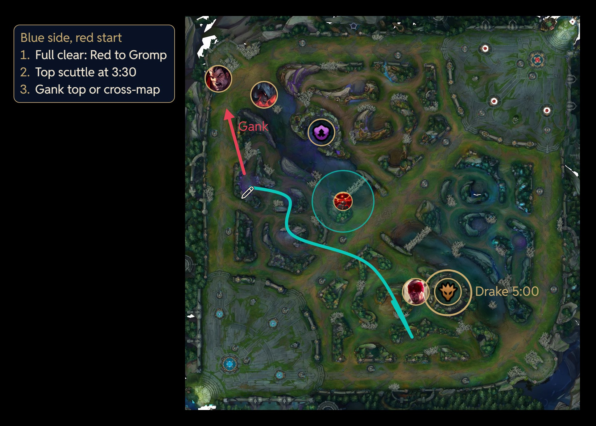
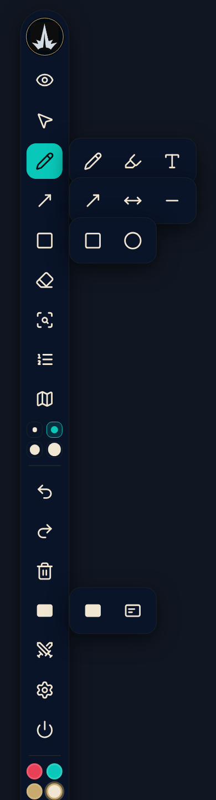
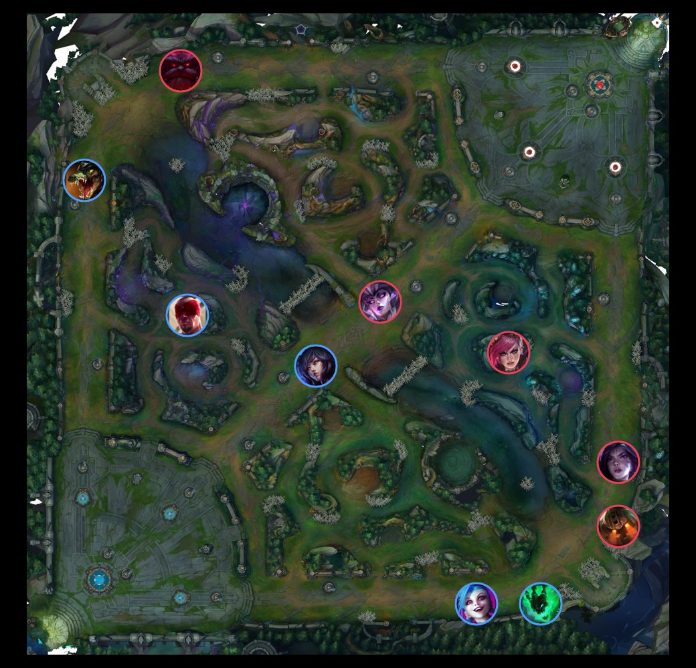
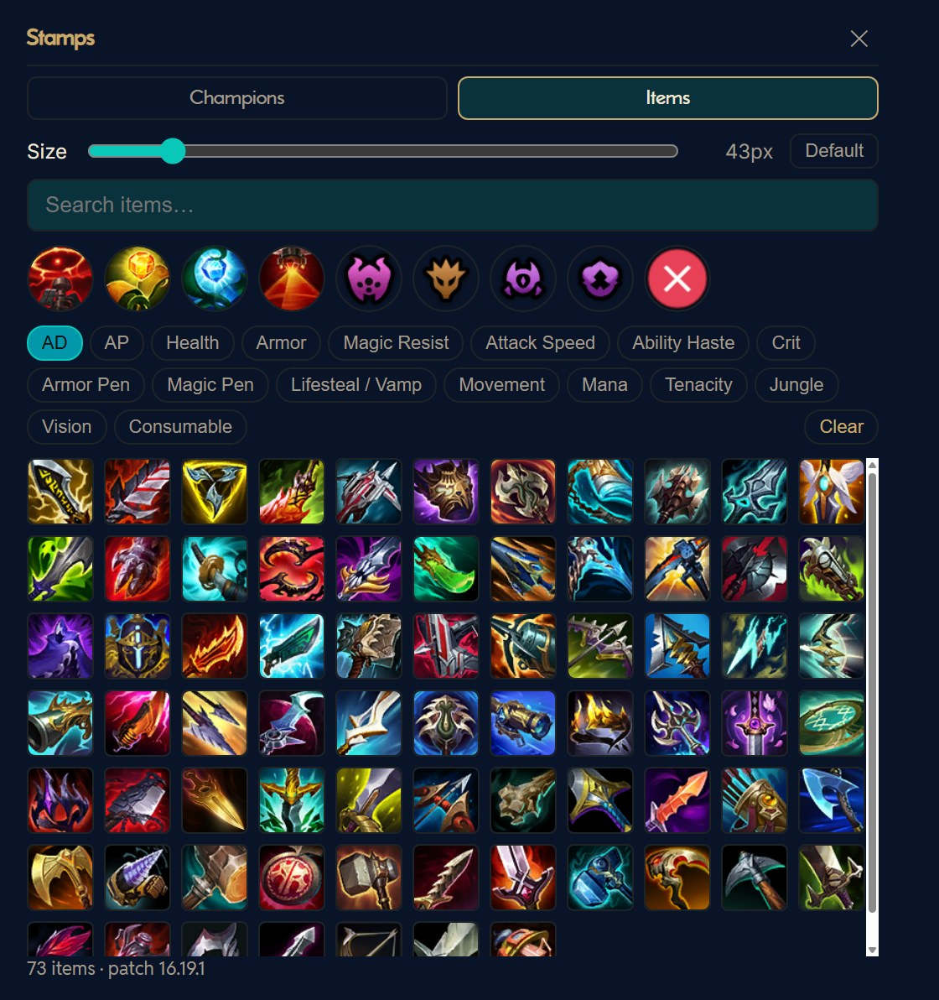
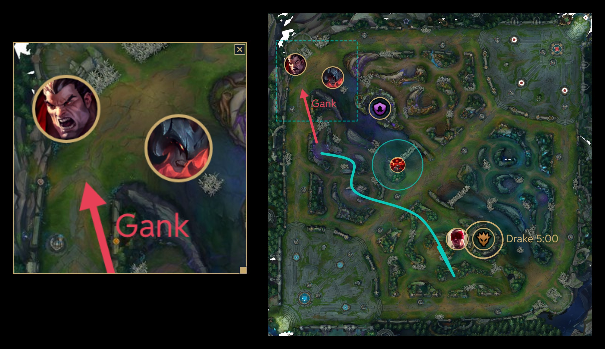
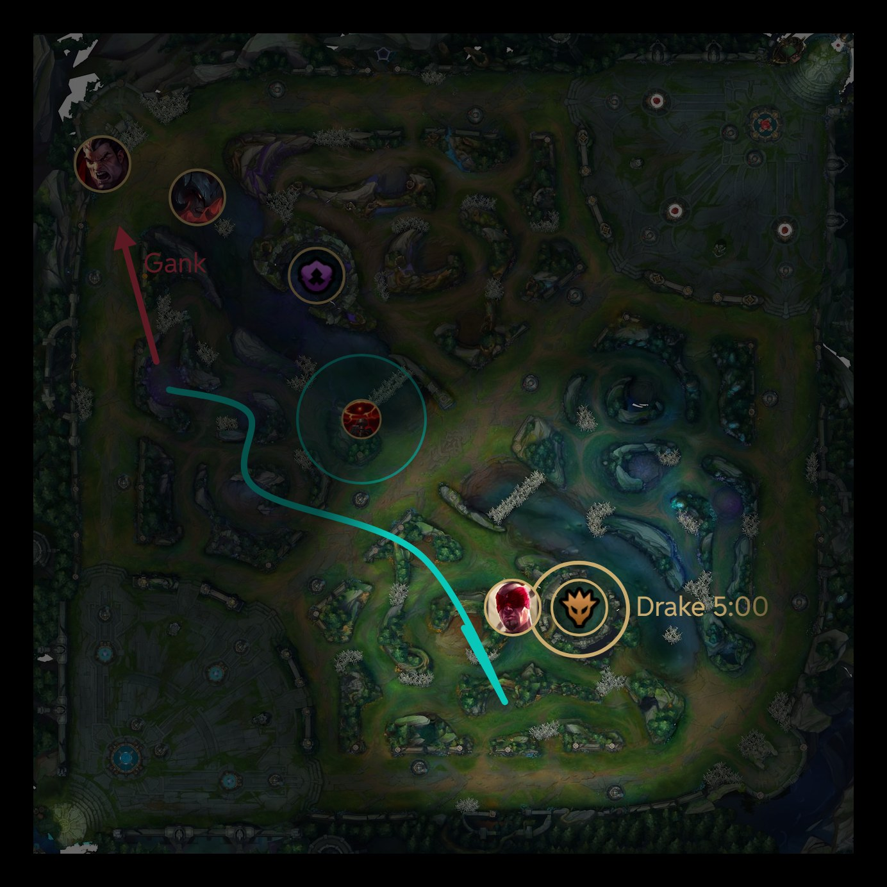
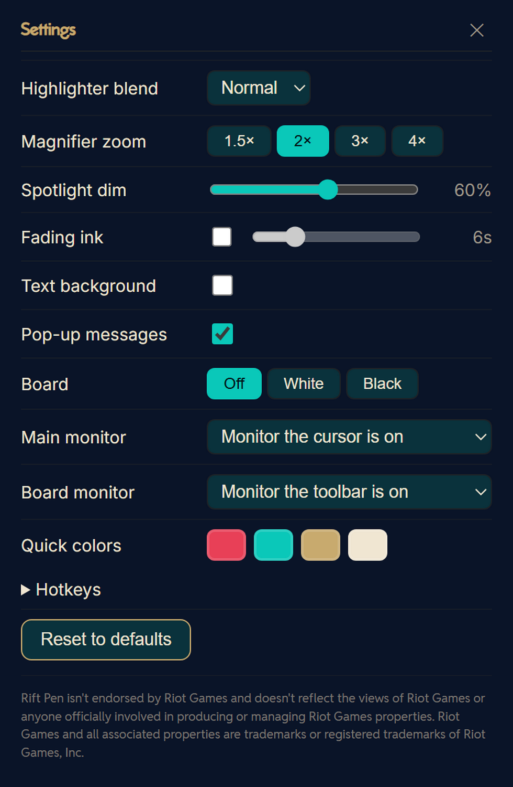

# Rift Pen

Rift Pen is Jungle Kingdom's League-themed screen-annotation overlay for Windows: draw, highlight,
zoom and spotlight over anything on screen while you coach.

**[Download the latest installer](https://github.com/Jungle-Kingdom/rift-pen-releases/releases/latest)**
(`RiftPen-Setup-<version>.exe`). Updates download in the background and install when you quit
(tray: Restart to update).

Rift Pen draws on top of whatever is on your screen: a VOD, a live game, a browser tab, OBS. You
pull the pen out, draw, and put it away again. While the pen is away your mouse works normally on
whatever is underneath.

This page covers what is in the app and how to use each part.

**Contents**

1. [Before you start](#1-before-you-start)
2. [Your first two minutes](#2-your-first-two-minutes)
3. [The toolbar](#3-the-toolbar)
4. [Drawing tools](#4-drawing-tools)
5. [The Rift map](#5-the-rift-map)
6. [Stamps](#6-stamps)
7. [Zoom](#7-zoom)
8. [Spotlight](#8-spotlight)
9. [Numbered notes](#9-numbered-notes)
10. [Boards, fading ink, screenshots](#10-boards-fading-ink-screenshots)
11. [Settings](#11-settings)
12. [Hotkeys](#12-hotkeys)
13. [What Clear removes and what it keeps](#13-what-clear-removes-and-what-it-keeps)
14. [When something looks wrong](#14-when-something-looks-wrong)

---

## 1. Before you start

1. Install `RiftPen-Setup-<version>.exe` from the
   [latest release](https://github.com/Jungle-Kingdom/rift-pen-releases/releases/latest). Windows
   shows "Windows protected your PC" once: click **More info**, then **Run anyway**.
2. Run League in **Borderless**, not exclusive Fullscreen. No overlay can draw over a true
   exclusive-fullscreen game.

No account is needed. Rift Pen opens straight to the pen, with every tool and stamp.

Once it is running you get a small vertical toolbar and a tray icon. Rift Pen has no taskbar
button of its own. To get one, open Start, right-click **Rift Pen**, and choose **Pin to taskbar**.

---

## 2. Your first two minutes

1. **Pull the pen out.** Click the pencil on the toolbar, click the tray icon, or press
   `Ctrl+Alt+D`. The pencil lights up teal and your cursor becomes a pen.
2. **Draw something.** Drag anywhere on screen.
3. **Change color and size.** Click one of the four color dots at the bottom of the bar and one of
   the four size dots in the middle.
4. **Take it back.** `Ctrl+Alt+Z` undoes the last thing you drew. The trash can (`Ctrl+Alt+C`)
   wipes the screen.
5. **Put the pen away.** Press `Esc`, click the lit tool again, or click the cursor arrow near the
   top of the bar. Your clicks go to the game or video again. What you drew stays on screen.

That loop (pen out, draw, pen away) is the whole app. Everything below is something extra you can
put on screen.

---

## 3. The toolbar

Three of the tool buttons, and the board button, are **hover groups**. Hover to fan out the
choices, click one, and the button remembers it:

Things worth knowing:

- **Picking any tool pulls the pen out.** Clicking the tool that is already lit puts the pen away.
- **Numbered notes** and **Rift map** are not tools. They put a panel on screen and leave your pen
  exactly as it was.
- **Drag the logo** at the top to move the bar. `Ctrl+Alt+H` hides and shows it.
- **The eye** hides everything you have drawn without deleting it. Click it again to bring it back.
  Hiding with the eye also closes an open Stamps or Settings panel, and turning it back on
  reopens it.
- **Hover any button** and it tells you what it does.
- A red dot on the gear means a hotkey could not be registered because another app owns it. Rebind
  it in Settings.

---

## 4. Drawing tools

| Tool | How to use it |
|---|---|
| Pen | Drag to draw freehand. |
| Highlighter | Drag for a wide see-through stroke. |
| Text | Click where you want it, type, press `Enter`. `Shift+Enter` starts a new line, `Esc` cancels. |
| Arrow, Double arrow, Line | Drag from start to end. |
| Rectangle, Ellipse | Drag corner to corner. |
| Eraser | Click or drag over a shape to remove the whole shape. |
| Freeze | Click to freeze the whole screen, or drag to freeze an area (see [section 4a](#4a-freeze)). |

- **Hold `Shift`** while dragging for straight angles, perfect squares and perfect circles.
- **Size dots** set stroke width and text size together.
- **If the text box says "Click to type"**, another app that runs as administrator (like the Jungle
  HUD) has the keyboard. Click the box once and your typing goes into Rift Pen.
- **Edit text** by clicking it with the Text tool. **Move text** by dragging it with any drawing
  tool.
- **Undo and redo** have their own buttons on the bar as well as `Ctrl+Alt+Z` / `Ctrl+Alt+Y`.
  Erasing is undoable too.

### 4a. Freeze

Freeze stops the picture under your ink while the video keeps playing, so you can draw on a
moment and keep talking.

- **Freeze the screen:** pick the Freeze tool and click, or press `Ctrl+Alt+F`. It freezes the
  monitor your cursor is on.
- **Freeze an area:** drag a box with the Freeze tool. The frozen area starts exactly where it was
  taken. Drag its body to move it, drag the grip in its bottom-right corner or scroll the wheel over
  it to resize it (it keeps its shape; scrolling grows it around your cursor), and close it with its X.
- **Unfreeze:** `Ctrl+Alt+F` again, a click with the Freeze tool on a frozen screen, or the area's X.
- **Draw on it** with any ink tool. With the pen out, moving or resizing a frozen area needs the
  Freeze tool picked; any other tool draws on it. Its X closes it under any tool.
- **With the pen away,** clicks pass through to the video underneath, except over a frozen area:
  its body is a handle. Drag it to move it, drag the grip to resize it, X to close it.
- **Unfreezing takes the ink you drew during the freeze with it.** Ink from before the freeze stays,
  and so do replay champions. Undo brings the frozen picture and that ink back.
- **Clear** wipes the ink but keeps the frozen picture.
- Freeze and the zoom box start almost instantly while the pen is out, because the screen capture
  stays ready on the monitor your cursor is on.
- There is one freeze per monitor. Freeze is also in the tray menu and the Settings hotkey list.

---

## 5. The Rift map

A picture of Summoner's Rift you can draw on. Use it to lay out a clear, a gank path, vision, or an
objective setup without needing a game on screen.

- **Show or hide it:** the map button on the toolbar, or `Ctrl+Alt+R`. It comes up on the monitor
  your cursor is on.
- **Resize it:** scroll the wheel over the map.
- **Move it:** with the pen away, drag the map anywhere. With the pen out, drag the thin strip
  along its top edge (it turns gold when you hover it), because a drag on the map itself draws.
- **Draw on it:** pull the pen out and draw. Stamps, arrows and text all land on top of it.
- **Replay champions:** the ten champions of a League replay can be placed on the map in their
  lanes (see [section 6](#this-game-a-replays-ten-champions)). With the pen away, press on one to
  drag it, wherever it is. They move and resize with the map. Hiding the map removes them, and
  `Show on map` in the Stamps picker brings them back. One undo also brings the map back with its
  champions. The map button also closes the Stamps picker, so reopen the picker first.

Put the map where you want it **before** you draw. Your ink belongs to the screen, not to the map,
so moving the map afterwards leaves the drawing behind. The replay champions are the exception:
they are part of the map setup, so they travel with it. A champion you resized yourself keeps its
size relative to the map when the map moves or is resized.

With the pen away, a press on a champion drags that champion and a press anywhere else on the map
drags the map.

The picture above pairs it with a blackboard (see [section 10](#10-boards-fading-ink-screenshots))
so nothing else is on screen. Without a board the map sits over your game or video.

---

## 6. Stamps

Stamps are icons you place on screen: champions, items, wards and objectives. Click the crossed
swords on the toolbar to open the picker.

1. **Pick one.** It gets a teal ring, and the pen comes out with the stamp armed.
2. **Click on screen** to place it. Click again somewhere else to place another. The picker stays
   open, so a whole team comp is pick, click, pick, click.
3. **Move a stamp** by dragging it, with the pen out or put away. **Resize it** by scrolling the wheel
   over it.
4. **Remove one** with the eraser, or press `Delete` right after placing or clicking it.

What is in the picker:

- **Champions tab:** every champion, with a search box, in Top, Jungle, Mid, Bot and Support
  sections (a champion who plays two roles shows in both). The position chips narrow to those
  roles; pick several to see several. Always on the current patch.
- **Items tab:** every Summoner's Rift item, grouped into AD, AP, Tank, Support, Boots, Starters
  and Consumables, most expensive first inside each group. The stat chips still narrow to items
  that give every stat you picked.
- **The marker row** above the grid is always there: Control Ward, Stealth Ward, Farsight, Oracle
  Lens, then Baron, Dragon, Herald, Grubs, and a red X.
- **Ward stamps place with a vision circle** around them (the teal ring in the map picture above).
  Scroll over the ward to make the circle bigger or smaller.
- **Size slider:** how big new champion and item stamps are placed. **Default** puts it back.
- **The This game row** on the Champions tab: see below.

### This game: a replay's ten champions

Under the marker row, **This game** shows the ten champions of your most recent League replay: the
blue team first, then the red team, each in lane order (Top, Jungle, Mid, Bot, Support). Every one
is a stamp like any other: pick it and click on screen to place it.

- **`Import replay…`** picks a different replay file (`.rofl`). You can also drop the file onto the
  picker, but with the pen out the overlay covers Explorer, so use the button then.
- **`Latest`** appears once you have imported a file. It goes back to your newest replay.
- **`Show on map`** opens the Rift map and puts both teams in their lanes, blue rings and red
  rings. Importing or dropping a replay does this for you. Opening the picker never does. With two
  monitors, the champions go on the monitor under your cursor if the map is up there. Otherwise
  they go on the monitor that already shows the map. Only when no map is up does the monitor under
  your cursor get one.
- **`Remove all on map`** takes the champions off the map and leaves the map up.

Once they are on the map, the eraser takes one champion at a time. Undo takes back a whole
placement in one press, and the same goes for placing them again, `Remove all on map` and hiding
the map. The undo hotkey only works while the pen is out or something is drawn on screen; with
the pen away and nothing drawn, use the toolbar's undo button. With the pen away, press on a
champion to drag it, even if you dragged it off the map.
Scroll the wheel over a champion with the stamp tool to give it its own size.

League keeps replays in `Documents\League of Legends\Replays`. A replay only exists as a file once
you have downloaded it in the League client. The app reads the champions, teams and lanes from the
file and nothing else: no player names.

Champion, item and ward icons load from Riot's servers, so the picker needs an internet connection.
The objective markers and the red X work offline.

---

## 7. Zoom

There are two ways to enlarge part of the screen.

### Zoom box

A live, enlarged copy of one area that stays on screen while you talk over it. Video underneath
keeps playing inside it.

1. Click the **Zoom box** tool on the toolbar.
2. **Drag a box** around the area you want bigger. The dashed teal box marks it, and the enlarged
   panel with the gold border appears beside it.
3. **Drag the panel** to move it. **Scroll** to zoom in or out, or drag the gold square in its
   bottom-right corner.
4. **Close it** with the X in its top-right corner (it shows when your cursor is on the panel), by
   clicking empty space with the Zoom box tool, or by dragging a new box.

You can draw on top of the enlarged panel like anywhere else. Settings has the starting zoom level
(1.5x, 2x, 3x or 4x).

### Cursor zoom

A round magnifying glass that follows your cursor.

- **Turn it on or off:** `Ctrl+Alt+M`, or the tray menu.
- **Scroll** to change how much it magnifies.
- It shows a **frozen snapshot** of the screen from the moment you turned it on. If the screen has
  changed, use tray menu > **Cursor zoom: refresh**, or turn it off and on again.
- `Esc` takes it down.

Use the zoom box when the thing you are showing is moving. Use cursor zoom for a quick look at
something still, like a paused VOD or a scoreboard.

---

## 8. Spotlight

Dims the whole screen except a circle around your cursor, so the viewer looks where you point.

- **Turn it on or off:** `Ctrl+Alt+S`, or the tray menu.
- **Scroll** to make the circle bigger or smaller.
- **How dark** the rest of the screen goes is the **Spotlight dim** slider in Settings.
- With more than one monitor, every screen dims and the circle follows your cursor between them.
- `Esc` or Clear everything takes it down.

---

## 9. Numbered notes

A small list of talking points that stays on screen (top-left of the map picture in
[section 5](#5-the-rift-map)).

1. Press `Ctrl+Alt+G`, or click the notes button on the toolbar.
2. Type a line and press `Enter`. The **first line is the heading**, shown in gold with no number.
   Every line after it is a numbered point. The box stays open for the next one.
3. Press `Esc` when you are done typing.

After that:

- **Click a line** to edit it. Clearing it to empty deletes that line.
- **Drag the panel** by its body to move it. **Scroll over it** to make the text bigger or smaller.
- **Hover the panel** for its own buttons: add a point, hide the list (it is kept),
  copy the whole list to the clipboard, remove the last line, clear the list.
- The notes button on the toolbar hides and shows the list without losing it.

Opening the notes never pulls the pen out and never changes your tool. If the pen was away, clicks
keep going to the game while you type.

---

## 10. Boards, fading ink, screenshots

- **Whiteboard / Blackboard:** covers the screen with a solid white or black board to draw on.
  Hover the board button on the toolbar and pick one, or press `Ctrl+Alt+B` to cycle. Click it
  again to turn it off. Settings > **Board monitor** picks which screen it covers, so you can black
  out one monitor and keep the game on another.
- **Fading ink:** strokes fade out on their own after a few seconds (2 to 20). Good for live
  commentary where you never want to stop and clear. Turn it on in Settings. Stamps do not fade.
- **Screenshot:** `Ctrl+Alt+P` saves the screen with your drawings to `Pictures\RiftPen` and copies
  it to the clipboard. On a whiteboard or blackboard the shot includes the Rift map and its champions.
- **Hide everything:** the eye button or `Ctrl+Alt+V` hides all of your drawings and panels and
  brings them back untouched.

---

## 11. Settings

Open it with the gear on the toolbar, or tray menu > **Settings**.

| Setting | What it does |
|---|---|
| Highlighter blend | Normal, or Multiply (darkens what is under it, like a real highlighter). |
| Magnifier zoom | Starting zoom for the zoom box and cursor zoom. |
| Spotlight dim | How dark the screen goes outside the spotlight circle. |
| Fading ink | Turn fading on, and set how many seconds a stroke lasts. |
| Text background | Puts a dark plate behind text so it reads over a busy screen. |
| Pop-up messages | Off silences the "Cleared", "Saved" and "Copied" confirmations. Errors still show. |
| Main monitor | Where the notes, the Rift map and replay champions open. The default follows the cursor. |
| Board / Board monitor | Whiteboard or blackboard, and which screen it covers. |
| Quick colors | Change the four color dots on the toolbar. |
| Hotkeys | Click a shortcut, then press the new combination. **Reset hotkeys** restores the defaults. |
| Reset to defaults | Puts the settings back the way they shipped. |

Everything is saved between sessions.

---

## 12. Hotkeys

| Action | Shortcut |
|---|---|
| Pen out / pen away (brings back the last tool) | `Ctrl+Alt+D` |
| Pen: switch straight to the pen; again goes back to the cursor | `Ctrl+Alt+N` |
| Put the pen away, drop spotlight and cursor zoom | `Esc` |
| Undo / Redo | `Ctrl+Alt+Z` / `Ctrl+Alt+Y` |
| Clear everything | `Ctrl+Alt+C` |
| Delete the selected stamp | `Delete` |
| Rift map: show / hide | `Ctrl+Alt+R` |
| Spotlight | `Ctrl+Alt+S` |
| Cursor zoom | `Ctrl+Alt+M` |
| Freeze / unfreeze the screen | `Ctrl+Alt+F` |
| Numbered notes: add a line | `Ctrl+Alt+G` |
| Numbered notes: remove last line / clear list | `Ctrl+Alt+Shift+G` / `Ctrl+Alt+Shift+C` |
| Whiteboard / Blackboard | `Ctrl+Alt+B` |
| Screenshot | `Ctrl+Alt+P` |
| Hide / show your drawings | `Ctrl+Alt+V` |
| Hide / show the toolbar | `Ctrl+Alt+H` |
| Quit | `Ctrl+Alt+Q` |

All of them can be changed in Settings > Hotkeys. `Esc` and `Delete` only belong to Rift Pen while
the pen is out. Undo, redo and clear only belong to it while something of yours is on screen.
Otherwise those keys go to whatever app you are using.

---

## 13. What Clear removes and what it keeps

The trash can and `Ctrl+Alt+C` wipe every screen at once. One undo brings back what it removed.

| On screen | Clear everything | How to remove it instead |
|---|---|---|
| Pen, highlighter, shapes, arrows, text | Removed | |
| Stamps | Removed | |
| Spotlight, cursor zoom | Turned off | |
| Zoom box | **Kept** | Its own X, or a click with the Zoom box tool |
| Rift map | **Kept** | The map button, or `Ctrl+Alt+R` |
| Numbered notes | **Kept** | The panel's own remove and clear buttons |
| Frozen picture | **Kept** (its ink is removed) | `Ctrl+Alt+F`, the Freeze tool, or the area's X |
| Map champions (from a replay) | **Kept** | `Remove all on map` in the Stamps picker, or hide the map |

The five that stay are the things you keep talking over between diagrams.

---

## 14. When something looks wrong

| What you see | What to do |
|---|---|
| Nothing shows over League | Switch the game to Borderless. Exclusive Fullscreen cannot be drawn over. |
| My clicks are not reaching the game | The pen is out. Press `Esc` or click the cursor arrow on the bar. |
| A hotkey does nothing | Another app owns it. The gear shows a red dot; rebind the key in Settings > Hotkeys. |
| I cannot find the toolbar | `Ctrl+Alt+H`, or tray menu > Show / hide toolbar. |
| Champion or item stamps will not load | Check your internet, then close and reopen the picker. The marker row still works offline. |
| "No replay found" under This game | Nothing is in `Documents\League of Legends\Replays` yet. Download a replay in the League client, or use `Import replay…`. |
| "Could not read that replay" | The file is old or damaged. Try a recent replay. |
| "Not a replay file" | The replay you dropped is on a network location (such as `\\server\share`), or is not a file on this computer. Use `Import replay…`, which opens it, or copy the replay to this computer first. |
| An error stays under This game for a moment, then the game's name comes back | That is normal. A failed import or drop clears its message after about 4 seconds and the row goes on showing the replay it had. |
| "No lane positions in this replay" | The mode has no lanes, such as ARAM. The This game row still works; placing them on the map does not. |
| The cursor zoom shows an old picture | It is a snapshot. Tray menu > Cursor zoom: refresh. |
| My drawing did not move with the map | Ink stays where you drew it. Place the map first, then draw. |
| I typed and the game lost focus | Text and notes need the keyboard while you type. Click the game to give it back. |
| The toolbar or my drawings blinked and the ink is gone | That window crashed and reloaded itself. Keep going; if it repeats, send the files in the next row. |
| Rift Pen closed by itself | Open it again, then paste `%APPDATA%\Rift Pen` into the Explorer address bar and send `rift-pen-errors.log` plus the newest file in `Crashpad\reports`. Nothing is uploaded on its own. |

---

Rift Pen isn't endorsed by Riot Games and doesn't reflect the views or opinions of Riot Games or
anyone officially involved in producing or managing Riot Games properties.

The pictures on this page are generated from the app itself by `npm run docs:images`
(`scripts/docs/capture-guide-images.cjs`). Re-run it after a UI change and commit the result.
